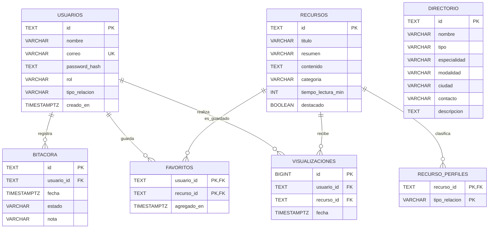

Modelo implementado en `sql/schema.sql`. Se utiliza **PostgreSQL**, con claves primarias, foráneas, restricciones `CHECK`, índices y eliminaciones en cascada para los datos dependientes.

**Decisiones de modelado:** `usuarios` es el dueño de bitácoras y favoritos; `recurso_perfiles` resuelve la relación muchos-a-muchos entre recursos y perfiles de apoyo; `visualizaciones` registra visitas efectivas para métricas del administrador, diferenciándolas de contadores simulados de EP1. `directorio` está desacoplado del recurso porque registra entidades de apoyo, no contenidos educativos.

**Datos sensibles:** se almacenan hashes de contraseñas bcrypt, nunca contraseñas planas; cada consulta de bitácora y favoritos se filtra por el ID autenticado mediante JWT validado. El administrador no dispone de endpoints para leer bitácoras privadas.

**Datos de prueba:** `seed.sql` carga 8 recursos educativos del prototipo y 3 entradas de directorio claramente etiquetadas como *demostración*, sin presentar instituciones o contactos ficticios como servicios reales. No se crea ninguna cuenta de administrador mediante el registro abierto.

**Reproducción:** crear una BD vacía (`createdb -U postgres red_apoyo`), ejecutar `psql -U postgres -d red_apoyo -f sql/schema.sql` y después `psql -U postgres -d red_apoyo -f sql/seed.sql`. Configurar las variables del backend y usar `npm run seed:admin` para cargar una cuenta administrativa elegida por el grupo.
